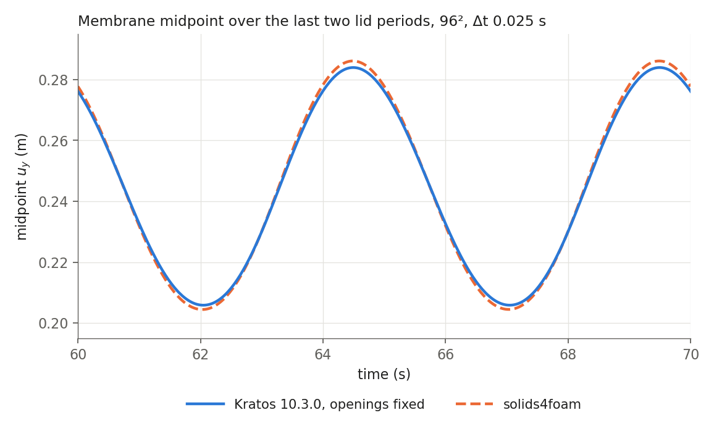

# mokLidDrivenCavity with Kratos Multiphysics (group B)

An independent-code solution of the lid-driven cavity with a flexible bottom, group-B definition, for
`sec:mok`. Kratos shares no code with solids4foam. This folder holds the inputs, the mesh generator, the
scripts, every run's membrane-midpoint history and coupling record, and the tables and figures. No `.tex`
file is changed. Discussion: issue #36.

**Main result.** The Kratos example lets the inlet and outlet nodes slide up the side walls with the
mesh, so its openings shrink by about 15% at the peak and it does not solve the group-B problem. With
the openings fixed in space, Kratos and solids4foam agree to within 0.8% (peak), 0.7% (trough) and
0.13% (mean) at 96²/Δt 0.025 s, and the largest history difference falls from 12.5 mm to 2.4 mm over
the four shared levels.

## Code and platform

- Kratos Multiphysics 10.3.0 from PyPI: KratosMultiphysics, KratosFSIApplication,
  KratosFluidDynamicsApplication, KratosStructuralMechanicsApplication, KratosMeshMovingApplication,
  KratosMappingApplication and KratosLinearSolversApplication, all 10.3.0, with numpy 2.4.6 and
  CPython 3.11.18. 10.3.0 is the newest release with a complete set of wheels for glibc 2.27.
- A UCD workstation: Intel i9-10900X (10 cores), 62 GB, Ubuntu 18.04.6. Runs use OpenMP with 1 to 8
  threads. Every run's `run_info.json` records the version string, host, CPU and thread count.

## Problem and discretisation

The group-B definition of the solids4foam tutorial
(`tutorials/fluidSolidInteraction/mokLidDrivenCavity/verification/README.md`): a 1 m cavity with lid
velocity 1 − cos(2πt/5), ρ_f = 1, ν_f = 0.01, a membrane of thickness 0.002 m below y = 0 with
E = 250 Pa, ν_s = 0, ρ_s = 500, clamped at both ends and traction-free underneath, an inflow
u_x = v̄(8y − 7) over 0.875 ≤ y ≤ 1 on the left wall, and p = 0 over 0.875 ≤ y ≤ 1 on the right wall.

- **Fluid.** P1/P1 triangles on a structured n × n mesh (the '/' diagonal of the shipped mesh), VMS
  stabilisation, Bossak time integration with α_m = −0.3, AMGCL linear solver.
- **Solid.** Q1 total-Lagrangian elements with `LinearElasticPlaneStress2DLaw` on the Green–Lagrange
  strain, which is St Venant–Kirchhoff. Plane stress and plane strain coincide at ν = 0. Bossak with
  α_m = −0.3. The solid has n elements along the membrane, so the interface nodes of fluid and solid
  coincide, and 2 elements through the thickness unless stated.
- **Mesh motion.** Structural similarity, solved at every coupling iteration.
- **Coupling.** Dirichlet–Neumann with MVQN. A step is converged when the RMS interface displacement
  residual |r|/√n_DOF is below `nl_tol` = 1e-6 m (an absolute test). Kratos accepts a step that reaches
  `nl_max_it` = 20 with only a warning, so `MainKratos.py` records whether each step met `nl_tol` and its
  residual at acceptance.
- **QoIs.** The vertical displacement of the solid node at (0.5, 0), every step. Peak, trough, mean and
  peak phase over t = 20–70 s with `periodic_stats` from the solids4foam driver
  (`mok_lid_driven_cavity_verification.py`, solids4foam commit `ba69872`), so the definitions are those of
  the solids4foam study.

## The openings move with the mesh in the Kratos example

The shipped mesh constrains the mesh displacement in x on the side walls and in y on the lid. The inlet
and outlet nodes can therefore slide up the walls, and their boundary conditions move with them. On the
32² mesh at the peak, the node at y = 0.875 rises by 17–21 mm, so both openings are about 0.105 m tall
instead of 0.125 m. solids4foam fixes the mesh points of its inlet, outlet and lid patches, as the
group-B definition requires. With `make_case.py --fix-openings`, the side-wall nodes with y ≥ 0.875 on
both walls (x = 0 and x = 1), including the node at y = 0.875, join the `ALEMeshDisplacementBC2D_ALEMeshBCy`
SubModelPart, so their mesh displacement is fixed to zero in y as well as in x, from t = 0 for the whole
run (process interval `[0, End]`). That adds n/8 nodes per wall to the lid row already fixed in y.
Runs with fixed openings end in `_fixopen` and are the group-B results. The runs
without it reproduce the example's problem and show how much the openings matter.

| Level | Peak, shipped mesh (m) | Peak, openings fixed (m) | solids4foam (m) |
|---|---|---|---|
| 16², Δt 0.2 | 0.2616 | 0.2875 | 0.2934 |
| 32², Δt 0.1 | 0.2620 | 0.2882 | 0.2889 |
| 64², Δt 0.05 | 0.2581 | 0.2850 | 0.2870 |
| 96², Δt 0.025 | 0.2570 | 0.2839 | 0.2861 |

## Results with the openings fixed

### Against solids4foam on the same sequence

solids4foam values are recomputed from `../mok_coupling_test/` (legacy coupling test; `legacy0` for
16²) with the same `periodic_stats`. Kratos / solids4foam, with the difference relative to solids4foam:

| Level | Peak (m) | Trough (m) | Mean (m) | Max history difference |
|---|---|---|---|---|
| 16², Δt 0.2 | 0.2875 / 0.2934 (−2.0%) | 0.2052 / 0.1942 (+5.7%) | 0.2458 / 0.2426 (+1.3%) | 12.5 mm |
| 32², Δt 0.1 | 0.2882 / 0.2889 (−0.25%) | 0.2078 / 0.1986 (+4.6%) | 0.2473 / 0.2427 (+1.9%) | 9.6 mm |
| 64², Δt 0.05 | 0.2850 / 0.2870 (−0.70%) | 0.2063 / 0.2022 (+2.0%) | 0.2449 / 0.2438 (+0.48%) | 4.4 mm |
| 96², Δt 0.025 | 0.2839 / 0.2861 (−0.77%) | 0.2059 / 0.2044 (+0.71%) | 0.2442 / 0.2445 (−0.13%) | 2.4 mm |

`results/fixed_openings/combined_sequence.csv` gives the Kratos values on these four levels with the
observed order, the extrapolated value, the GCI and the difference of 96² from the extrapolation, for
peak, trough and mean (extrapolation from 32², 64² and 96²).



### Error sources

Observed orders, Richardson extrapolation and the fine-grid GCI (safety factor 1.25) follow Celik et al.
(2008, J. Fluids Eng. 130, 078001), with general refinement ratios. Full tables in
`results/fixed_openings/summary.md`.

| Source | Members | Result |
|---|---|---|
| Fluid mesh | 16², 32², 64², 128² at Δt 0.0125 s | 128²: peak 0.28348, trough 0.20574, mean 0.24392 m. Order from 32²–128²: 0.39 (peak), 1.91 (trough), 1.35 (mean). Extrapolated 0.28004 / 0.20553 / 0.24341 m, GCI 1.5% / 0.13% / 0.26% |
| Combined (the solids4foam sequence) | 32²/0.1, 64²/0.05, 96²/0.025 | Order 1.00 / 1.16 / 1.17. Extrapolated 0.28180 / 0.20515 / 0.24300 m, GCI 0.94% / 0.45% / 0.61% |
| Time step | 64², Δt 0.1, 0.05, 0.025, 0.0125 s, `dynamic_tau = 0` | Order 2.0–2.3 (trough, mean); peak changes below noise. Changes below 0.03% from Δt 0.025 s |
| Coupling | 128²/0.0125, `nl_tol` 1e-6 against 1e-8 with the fluid, solid, mesh and linear-solver tolerances 100× tighter | QoIs within 1e-6 m, histories within 4.9e-6 m |
| Solid through the thickness | 2, 4 and 8 elements at 64²/0.025 | Peak, trough and mean within 1e-5 m (below noise) |
| Outlet condition (model form) | u_y = 0 imposed on the outlet, at 32²/0.1 and 64²/0.025 | +0.02% / +0.77% / +0.32% at 32², +0.52% / +1.65% / +1.01% at 64² (peak / trough / mean) |

- **Time step and `dynamic_tau`.** The VMS stabilisation parameter is
  τ = 1/(ρ(dynamic_tau/Δt + 2|u|/h) + 4μ/h²) (`vms.h`, Kratos 10.3.0). With the example's
  `dynamic_tau = 1`, refining Δt on a fixed mesh also weakens the stabilisation, and in that study the
  changes grow as Δt falls (−0.06%, −0.06%, −0.10% on the peak). With `dynamic_tau = 0` the study
  measures the time error alone. The two settings differ by 0.22% (peak), 0.06% (trough) and 0.10%
  (mean) at 64²/Δt 0.0125 s, a mesh-dependent effect. All other runs use `dynamic_tau = 1`, as the
  example does.
- **Outlet.** solids4foam imposes p = 0 with a zero normal gradient of velocity. Kratos fixes p and
  leaves the velocity to the natural condition of its weak form. Kratos has no zero-gradient option, so
  u_y = 0 was tested as a sensitivity. Its effect is about the size of the remaining difference between
  the codes, which suggests about 1% of model-form uncertainty from the outlet.
- **Coupling iterations.** Every step of every run met `nl_tol`, and no step reached `nl_max_it`. The mean
  is 2.0–3.3 coupling iterations per step (about 2 in most runs, highest at Δt 0.2 s). Kratos runs 128²
  without difficulty.
- **Against the published group-B range.** Both converged solutions lie above the range for the peak
  (0.2619–0.2769 m) and the trough (0.1967–0.2033 m). Only the mean (about 0.243 m) is inside. The low
  end of the peak range is the Kratos example curve, which has the moving openings.

## Runs

36 runs, all finished with exit status 0. Names are
`n<fluid divisions>_dt<time step>_sy<solid elements through the thickness>[_tight1e-8][_outletuy0][_fixopen][_dtau0]`.

| Set | Jobs file | Runs |
|---|---|---|
| Level 1 on the shipped mesh | (by hand) | `L1_omp8`, `L1_omp1`: 32², Δt 0.1 s, 8 and 1 threads, agree to 2.2e-6 m |
| Shipped mesh (openings slide) | `campaigns/refinement_2026-11-09.txt` | 15 runs, including `n032_dt0.1_sy2`, the generator check, which matches `L1_omp8` to 2.9e-6 m |
| Openings fixed (group B) | `campaigns/fixopen_2026-11-09.txt` | 15 runs (`n032_dt0.1_sy2_fixopen` by hand) |
| Time step with `dynamic_tau = 0` | `campaigns/dtau0_2026-11-09.txt` | 4 runs at 64², openings fixed |

Cost on the workstation (runs shared the machine, so these are not clean timings): level 1 77 s on 8
threads (129 MB); 64²/0.0125 55 min on 1 thread; 96²/0.025 46 min on 2 threads; 128²/0.0125 103 min on
4 threads, and 118 min with the tight tolerances. Wall times are in `results/*/runs.csv`.

## Files

| Path | Contents |
|---|---|
| `case/` | The ported `ProjectParameters.json` and materials files (the template for `make_case.py`); `ORIGINAL.md` gives the source commit and sha256 of the original example |
| `scripts/make_case.py` | Writes an input set at any level: `--n`, `--dt`, `--solid-x`, `--solid-y`, `--nl-tol`, `--tight`, `--outlet-uy0`, `--fix-openings`, `--dynamic-tau`; records its options in `case.json` |
| `scripts/compare_mdpa.py`, `scripts/mdpa_inspect.py` | Mesh checks: geometry comparison of two `.mdpa` files, and SubModelPart bounding boxes |
| `scripts/MainKratos.py` | Runs a case and writes `history.csv` and `run_info.json` |
| `scripts/run_case.sh`, `scripts/run_queue.py` | Run one case, or a jobs file under a thread budget |
| `scripts/summarise_refinement.py` | All tables in `results/` |
| `scripts/plot_comparison.py`, `scripts/plot_issue_figure.py` | The two figures (need matplotlib) |
| `scripts/compare_level1.py` | Level-1 check against the digitised Kratos curve |
| `campaigns/` | Jobs files (`<campaign>.txt`) and queue logs (`<campaign>_queue.txt`) |
| `runs/<name>/` | `history.csv` (time, u_x and u_y at (0.5, 0), coupling solves, converged flag, RMS residual at acceptance, wall time per step), `case.json`, `run_info.json`, `run_meta.txt` |
| `results/fixed_openings/` | `summary.md`, `runs.csv`, `orders.csv` and `combined_sequence.csv` for the group-B runs |
| `results/shipped_mesh/` | The same for the shipped-mesh runs |
| `figures/` | `midpoint_history_96.png`, and `kratos_vs_solids4foam.png` (peak, trough and mean against level for both codes and both meshes, histories, per-level differences) |
| `SHA256SUMS` | Checksums of every file in this folder |

## Reproducing

From this folder, with Kratos 10.3.0 installed (`KRATOS_ENV` may name a script that activates it):

```bash
python scripts/make_case.py case gen/n064_dt0.025_sy2_fixopen --n 64 --dt 0.025 --fix-openings
scripts/run_case.sh gen/n064_dt0.025_sy2_fixopen myruns/n064_dt0.025_sy2_fixopen 1
```

The tables need the solids4foam driver (commit `ba69872`) and the solids4foam histories:

```bash
python scripts/summarise_refinement.py <solids4foam>/tutorials/fluidSolidInteraction/mokLidDrivenCavity/verification/scripts/mok_lid_driven_cavity_verification.py runs ../mok_coupling_test results/fixed_openings --fix-openings
```

Rerunning it reproduces `summary.md` exactly. A case generated and run from this layout reproduced
`runs/n016_dt0.2_sy2_fixopen/history.csv` to the last digit.

## Limitations

- The fluid stabilisation (`dynamic_tau`) and the outlet velocity condition are numerical and modelling
  choices that differ from solids4foam. Their effects are quantified above, at about 0.2% and about 1%.
- The peak converges slowly under mesh refinement. At Δt 0.0125 s the peaks for 16², 32², 64² and 128²
  are 0.28458, 0.28591, 0.28453 and 0.28348 m. From 32² the sequence is monotone and the last step is
  not flat (−1.38 mm, then −1.05 mm, 76% of the step before), which gives the order of 0.4; 16² lies
  below 32². The trough steps over the same levels are −6.07, −2.24 and −0.60 mm (order 1.9). On the
  combined sequence the peak steps are +0.67, −3.20 and −1.07 mm. The extrapolated peak (0.2800 m from
  the mesh study, 0.2818 m from the combined sequence) is therefore less certain than the trough and
  mean, and quoting the 128² value (0.2835 m) with a band down to those extrapolations is the safer form.
- The VTK fields (written every 1 s of simulated time) are not included; they are available on request.
